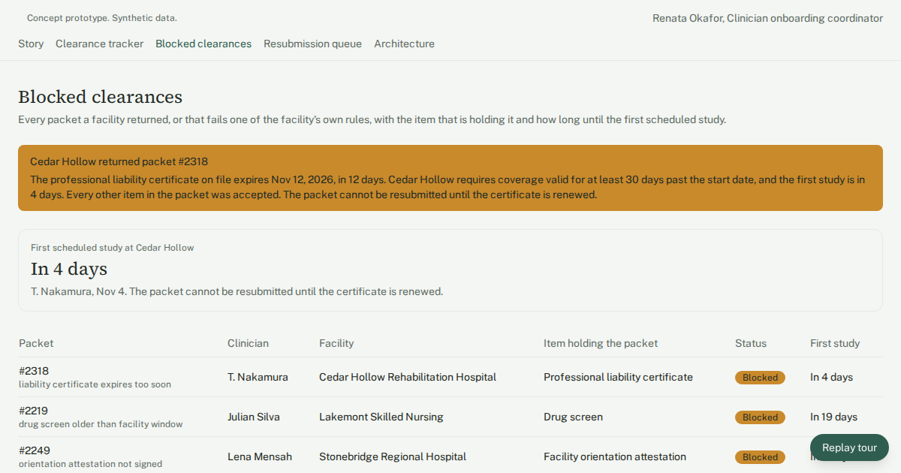

# Clinician clearance tracker for a mobile dysphagia diagnostics group

One view of which contract clinician is cleared at which partner facility, so a blocked packet gets seen before it cancels a start.

## Who has this problem

Small mobile diagnostics groups that send contract clinicians into hospitals, rehab hospitals and skilled nursing facilities. Each facility has its own clearance checklist: state license, professional liability certificate, background check, a drug screen inside the facility's window, a signed contractor agreement, and often an orientation attestation. The same clinician can be cleared at one site and blocked at the next.

Usually the documents sit in one shared-drive folder per clinician, the facility rules sit in a spreadsheet, and rejections arrive by email. In our scenario, a part-time onboarding coordinator keeps 14 contract speech-language pathologists cleared at 9 facilities in about 6 hours a week. Two delayed starts last quarter cancelled 4 study days at roughly $1,800 each. That is about $7,200 in lost revenue.

## What the demo shows

The guided tour has eight steps:

1. **Meet Renata.** The Story screen shows the coordinator's Monday before and after. Before, she checks files one by one, emails three facility offices, and finds a facility's return email at 9:40am, a day late. After, the blocked packet is already at the top of her list at 8:00am.
2. **Every clearance, one view.** The Clearance tracker lists all 64 clinician-facility packets. Each row shows status, the next missing item, and days until the clinician's first scheduled study. A facility filter narrows the list.
3. **The full packet history.** The Packet screen shows one timeline of documents, facility replies and follow-ups, with each document's status and expiration date. Staff can add a note or request a document from the clinician.
4. **A blocked start, caught early.** On Blocked clearances, packet #2318 for T. Nakamura at Cedar Hollow Rehabilitation Hospital sits at the top, flagged "liability certificate expires too soon". The certificate on file expires in 12 days. This facility requires coverage 30 days past the start date. The other 5 of 6 items were accepted.
5. **The start date is visible.** A countdown to the first scheduled study, computed from the shift date, reads "In 4 days". The drawer shows the renewed certificate the clinician already uploaded, valid for 377 days. Renata attaches it and moves the packet to the resubmission queue.
6. **Renata still decides.** In the Resubmission queue she checks the facility checklist against the attached documents, reads the drafted cover note, and clicks "Send packet to facility". The status changes to awaiting facility and the send is logged with a timestamp. She can also return the packet to the tracker for more documents.
7. **The numbers that matter.** The tracker computes four metrics from the packet data: clinician-facility pairs cleared, average days to clearance, blocked packets, and documents expiring in 30 days.
8. **How this would be built.** The architecture screen shows the real system behind the prototype.

## How it's built

A browser-only React + TypeScript + Tailwind app on the Umakes kit. There is no backend. All records are synthetic seed data: 14 clinicians, 9 fictional facilities, 64 clearance packets, 84 clinician documents and 150 packet notes.

The Umakes App Factory built and checked it. Automated gates run first. Then a reviewer uses the app: it clicked through all eight tour steps at desktop and phone widths, with no console errors.

The "How this would work" screen draws the production architecture: clinician document storage, facility credentialing offices, the tracker, Claude reading document dates and checking facility rules, Slack for owner alerts, and the coordinator as the approval step. It also lists the privacy choices behind each connection.

Known gaps from the last review, queued for the next pass: "Move to resubmission" and "Send packet to facility" do not yet wait for the renewed certificate to be attached. The draft cover note says the certificate is attached either way. Notes added on one packet can show up in other packets' timelines.

## What a production version adds

- **Real integrations.** Encrypted clinician document storage. Facility replies feeding the tracker. Claude reading expiration dates from uploads and checking each facility's rules. Slack alerts for the owner that carry only a packet number and status, never document images or background check results.
- **HIPAA controls.** Access limited to the owner and onboarding staff. Full audit logs. Encryption at rest and in transit. Signed BAAs with every vendor that touches the data, including the model provider, and only the minimum fields shared.
- **Hard approval gates.** No packet goes to a facility, and no clinician is marked cleared, without explicit staff action.
- **Deployment and ownership.** Runs on the client's own Google Cloud (GCP) project. The client owns the code, the data and the accounts.

## Try it

https://umakescloud-max.github.io/clinician-facility-clearance-tracker-v1/

This is a concept prototype, and every name and record in it is synthetic data. A real build runs on the client's own cloud, is HIPAA-ready, and belongs to the client.

If your team fights this every week, book a free workflow audit at umakes.cloud or reply to umakescloud@gmail.com.
